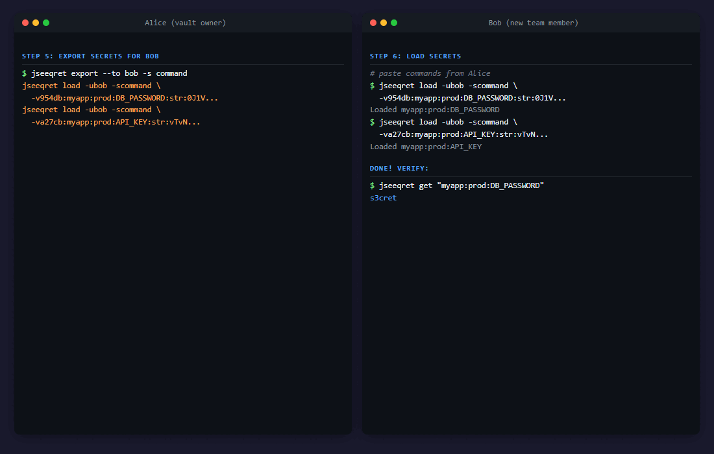

# jseeqret


[](https://codecov.io/gh/thebjorn/jseeqret)
[](https://www.npmjs.com/package/jseeqret)
[](https://badge.socket.dev/npm/package/jseeqret)
[](https://www.npmjs.com/package/jseeqret)

JavaScript/Electron/Svelte 5 port of [seeqret](https://github.com/thebjorn/seeqret) - a secure secrets manager.

**Fully compatible** with Python seeqret vaults - reads and writes the same database, encryption keys, and formats.

## Exchanging Secrets Between Users



Each user has their own vault with a keypair (X25519). The
`introduction` command outputs a ready-to-paste `add user` command
containing the user's public key. The `export -s command` serializer
outputs one `jseeqret load` command per secret — encrypted with the
recipient's public key, safe to send over Slack or email.

## Installation

### npm (library + CLI)

```bash
npm install -g jseeqret
```

### Windows installer

Download the signed installer from the
[latest release](https://github.com/thebjorn/jseeqret/releases/latest).

The installer ships the **GUI only** and does not add the `jseeqret`
command to your `PATH` -- the GUI covers the full onboarding flow, so a
terminal is never required. If you also want the CLI (e.g. for scripting
invites/approvals), install it separately with `npm install -g jseeqret`.

## CLI Usage

```bash
# Initialize a new vault (creates ./seeqret; your user is user@host)
jseeqret init . --email user@example.com
export JSEEQRET="$PWD/seeqret"    # Windows: setx JSEEQRET "%CD%\seeqret"

# Add a secret
jseeqret add key DB_PASSWORD "s3cret" --app myapp --env prod

# List secrets
jseeqret list
jseeqret list -f "myapp:prod:*"

# Get a secret value
jseeqret get "myapp:prod:DB_PASSWORD"

# Edit a secret
jseeqret edit value "myapp:prod:DB_PASSWORD" "new-value"

# Remove a secret
jseeqret rm key "myapp:prod:DB_PASSWORD"

# User management
jseeqret introduction            # your ready-to-paste `add user` command
jseeqret add user --username bob@hispc --email bob@example.com --pubkey <key>
jseeqret users
jseeqret whoami

# Multi-vault management
jseeqret vault add myvault /path/to/vault
jseeqret vault use myvault
jseeqret vault list

# Export/import
jseeqret backup -o vault.html   # password-protected, self-decrypting HTML
jseeqret export --to otheruser
jseeqret load -f export.json
jseeqret env                    # generate .env from template
jseeqret importenv .env         # import .env file

# Slack exchange, onboarding, ssh remotes
jseeqret send "myapp:prod:*" --to bob --via slack
jseeqret receive
jseeqret onboard invite --email new@example.com --project "myapp:*:*"
jseeqret push myhost "myapp:prod:*"
```

See the [CLI reference](https://thebjorn.github.io/jseeqret/documents/CLI_Reference.html)
for every command and option.

## Library API

```javascript
import { get, get_sync, init, close, reload } from 'jseeqret'

// Async
const value = await get('myapp:prod:DB_PASSWORD')
const same = await get('DB_PASSWORD', 'myapp', 'prod')

// Sync (after `await init()`)
const value = get_sync('myapp:prod:DB_PASSWORD')
```

A secret is named the same way as on the command line. Empty parts mean
`*` (`'::DB_PASSWORD'` is `'*:*:DB_PASSWORD'`), and `*` and other glob
characters are wildcards. The lookup must match exactly one secret:

- no match throws `SecretNotFound`, whose message names the
  `app:env:key` looked up, the vault file, and a `jseeqret list` command
  to find the key;
- several matches throw `AmbiguousSecret`, which lists the matching
  `app:env:key` names (`err.matches`), never their values;
- a malformed reference (e.g. `'myapp:prod'`), or one combined with the
  `app`/`env` arguments, throws an `Error`.

Both error classes are exported from `jseeqret` and `jseeqret/core`, as
is `parse_reference()`, which splits a reference into `[key, app, env]`.
This matches Python seeqret's `seeqret.get()`.

The database and key are cached after the first call. `reload()` re-reads
the vault (e.g. after the CLI changed it) and `close()` releases it.

## Electron GUI

```bash
pnpm dev       # development with hot reload
pnpm build     # production build
pnpm dist:nsis # build signed Windows installer
```

## Architecture

- `src/core/` - Shared library (crypto, storage, models, API)
- `src/cli/` - CLI interface (Commander.js)
- `src/main/` - Electron main process
- `src/preload/` - Electron preload (IPC bridge)
- `src/renderer/` - Svelte 5 UI with runes

## Encryption

- **At rest**: Fernet (AES-128-CBC + HMAC-SHA256) - identical to Python `cryptography.fernet`
- **In transit**: X25519 + XSalsa20-Poly1305 via tweetnacl - compatible with PyNaCl

## Dependencies

- `sql.js` - Pure JS SQLite (WASM, no native bindings)
- `tweetnacl` / `tweetnacl-util` - NaCl crypto
- `commander` - CLI framework
- `@slack/web-api` - Slack exchange transport
- `cli-table3` - Terminal tables
- `electron-vite` - Electron + Vite + Svelte 5

## License

MIT
